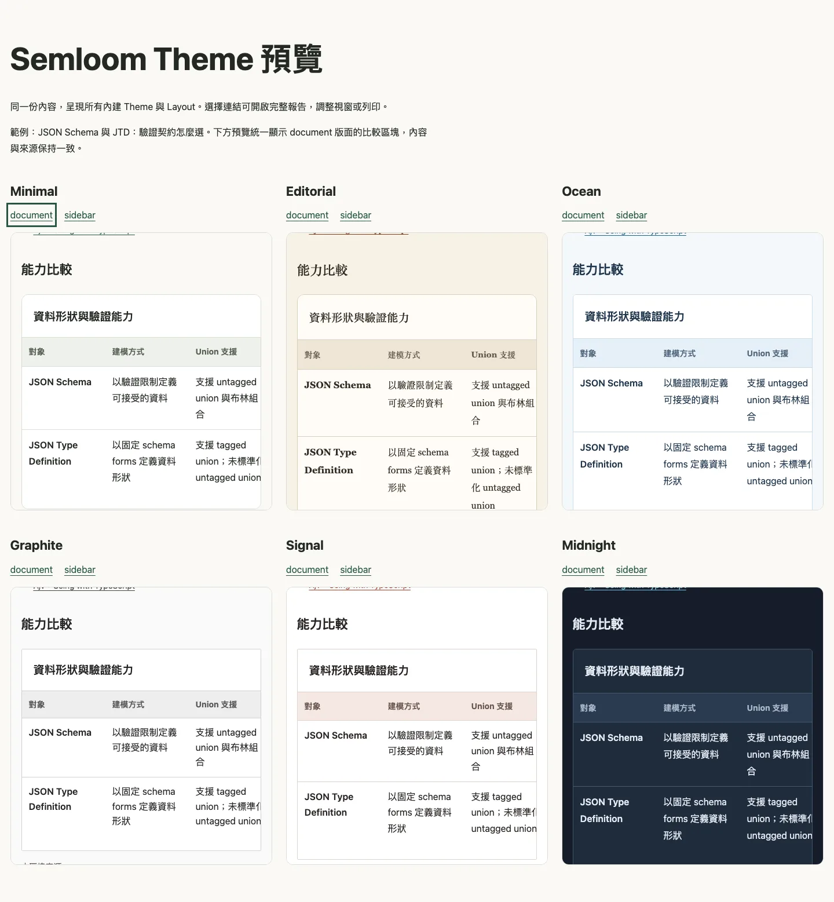

# Semloom

**專心寫內容，讓 Semloom 整理報告。**

[English](README.md) · 繁體中文

Semloom 將語意 JSON 編譯成一份獨立的 HTML 報告，適合研究比較、工程交接、專案摘要與流程說明。你可以自己撰寫資料，也可以請 coding agent 協助準備。

把內容保留在 JSON，選好呈現方式，就能分享 HTML。報告支援離線閱讀、小螢幕與列印；安裝相依套件後，編譯與閱讀都不需要 API key、伺服器、CDN 或遠端字體。

## 可以做什麼

- **結構化內容**：段落、比較、重點提示、數值摘要、步驟與時間軸，支援區塊層級的來源引用。
- **可重用的呈現方式**：六款 Theme、兩種 Layout，以及相容的區塊 Variant；調整外觀時保留語意資料。
- **明確的驗證**：匯出 JSON Schema、檢查欄位與引用，透過 `--explain` 查看實際呈現選擇。
- **可選的互動功能**：離線切換相容的比較呈現；停用 JavaScript 時仍保留完整內容。
- **Agent 與程式整合**：內附 skill、ESM API，並可載入可信任的本機 Plugin。

## 快速開始

需要 **Node.js 22（22.14 以上）或 24**；從原始碼使用還需要 **pnpm 10.28.2**。

如果已取得編譯完成的 `.tgz`，可安裝全域 CLI：

```sh
npm install --global ./semloom-VERSION.tgz
semloom --version
semloom --help
```

只要 npm 的全域執行檔目錄已在 PATH 中，就能在報告目錄直接執行 `semloom`。查找套件位置與註冊 skill 時，請使用同一套啟用中的 Node/npm；移除時執行 `npm uninstall --global semloom`。詳細方式請見[安裝指南](docs/releases.md#global-cli)。目前未提供公開的 npm registry 套件；GitHub Release 發布後，可從中取得編譯好的封裝。

若只想安裝在單一專案，執行 `npm install ./semloom-VERSION.tgz`，並改用 `npx --no-install semloom`。從原始碼使用則執行：

```sh
git clone https://github.com/CelloCello/semloom.git
cd semloom
pnpm install --frozen-lockfile
pnpm build
pnpm semloom build examples/pr-daily.json --theme ocean --layout sidebar -o reports/report.html
```

直接用瀏覽器開啟 `reports/report.html`。這是一份可以複製或分享的獨立檔案；PR 報告中的資料為示意資料。

以下指令使用全域 CLI。使用專案本機套件時，將 `semloom` 換成 `npx --no-install semloom`；在原始碼 checkout 根目錄則使用 `pnpm semloom`。

## 撰寫第一份報告

將以下內容存成 `report.json`：

```json
{
  "schemaVersion": "1.0",
  "title": "Project update",
  "sections": [
    {
      "id": "summary",
      "title": "Summary",
      "blocks": [
        { "kind": "prose", "text": "The migration is ready for review." }
      ]
    }
  ]
}
```

驗證資料並生成 HTML：

```sh
semloom validate report.json
semloom build report.json -o reports/project-update.html --explain
```

所有內容字串都視為純文字。來源引用屬於區塊，編譯器會檢查引用關係，但不會查證事實或替作者計算指標。支援欄位與限制請見[資料契約](docs/semantic-schema.md)。

## 選擇外觀

```sh
semloom build report.json --theme midnight --layout sidebar -o reports/project-update.html
semloom themes list
```

| Theme       | 風格                                         |
| ----------- | -------------------------------------------- |
| `minimal`   | 暖白底、綠色重點、本機無襯線字體；預設主題。 |
| `editorial` | 暖紙色、棕色重點、本機襯線字體。             |
| `ocean`     | 冷白底、深藍文字、海藍重點。                 |
| `graphite`  | 中性白與炭黑，較緊湊的閱讀節奏。             |
| `signal`    | 白底、厚重標題、磚紅重點。                   |
| `midnight`  | 深藍灰底、柔白文字、青藍連結。               |



Layout 可獨立選擇：`document` 將目錄放在內容上方；`sidebar` 在桌機使用側邊目錄，手機則使用可展開目錄。所有 Theme 都能搭配兩種 Layout，列印時會轉為淺色色票。

在 checkout 中執行 `pnpm demo:themes`，再開啟 `reports/themes/index.html`，即可比較全部十二種組合。樣式與擴充方式請見 [Themes and Layouts](docs/themes.md)。

## 搭配 coding agent

內附的 [Semloom skill](skills/semloom/SKILL.md) 可引導 Agent 讀取 Schema、撰寫語意資料、驗證及修改後重建。請依 [skill 安裝說明](docs/skills.md) 註冊到所用的 Agent；安裝套件不會自動完成 skill 註冊。

透過全域 CLI 匯出純 JSON 的 Schema：

```sh
mkdir -p reports
semloom schema > reports/semantic.schema.json
```

專案本機套件請使用 `npx --no-install semloom schema`；在 checkout 中則使用 `node dist/cli/main.js schema`，避免 `pnpm semloom` 將提示文字混入 stdout。使用本機 Plugin 時，`schema`、`validate` 與 `build` 應使用同一份 `--config`。[Agent 指南](docs/agent-guide.md) 說明內容、來源與設定的使用方式。

## 可選的互動報告

在原始碼 checkout 中，可用內附的比較範例試用：

```sh
pnpm semloom build examples/comparison.json --interactive -o reports/interactive.html
```

互動模式預設關閉。開啟後，讀者可以在報告內切換具備 browser adapter 的相容比較 Variant，不會發送網路請求。初始 HTML 仍保留完整內容，切換時區塊來源也會保留。詳細行為與擴充方式請見[互動報告](docs/interactive.md)。

## JavaScript API

已編譯的 checkout 與專案本機套件都能使用 ESM API。只安裝全域 CLI，不會讓其他專案檔案直接解析 `import 'semloom'`：

```js
import { readFile, writeFile } from 'node:fs/promises';
import { compile } from 'semloom';

const input = JSON.parse(await readFile('report.json', 'utf8'));
await writeFile('report.html', compile(input, { theme: 'ocean' }).html);
```

[本機 Plugin](docs/plugin-authoring.md) 可擴充 kind 與 Variant。Plugin 和 browser adapter 都會執行程式碼，請只載入可信任的模組；編譯器不會自動探索或安裝 Plugin。

## 範例與開發文件

| 文件                                 | 內容                                              |
| ------------------------------------ | ------------------------------------------------- |
| [範例導覽](examples/README.md)       | 研究比較、PR 交接、流程說明、區塊與 Plugin 範例。 |
| [展示指令](docs/showcase.md)         | 完整報告與 Theme 預覽的生成方式。                 |
| [CLI cookbook](docs/cli-cookbook.md) | 驗證、設定、Override 與錯誤診斷。                 |
| [架構](docs/architecture.md)         | 編譯邊界、渲染與擴充契約。                        |
| [評估方法](docs/evaluation.md)       | 可重現的量測與解讀限制。                          |
| [套件指南](docs/releases.md)         | 編譯產物的建立、安裝與驗證。                      |

參與開發時可執行：

```sh
pnpm browsers:install
pnpm check
pnpm test:package
```

固定評估情境可用 `pnpm benchmark` 執行。生成的報告、截圖與單次量測不納入版本控制。回報問題或提出建議時，歡迎[建立 issue](https://github.com/CelloCello/semloom/issues)，附上最小輸入與預期結果。

## 授權

[MIT](LICENSE)，© 2026 Semloom contributors。生成 HTML 內的 runtime 聲明適用於 Semloom 程式碼；輸入內容與引用來源的權利仍屬於各自權利人。
